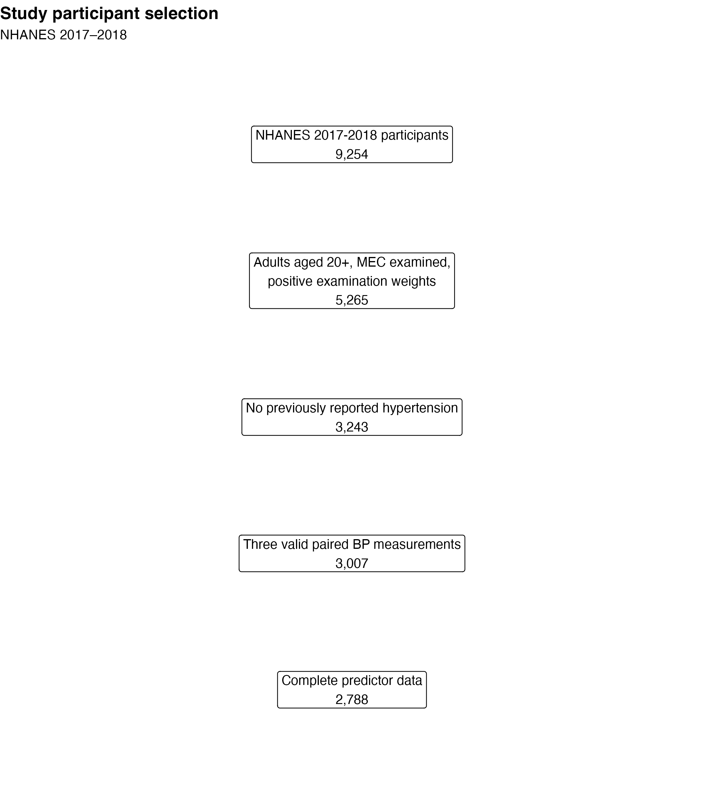
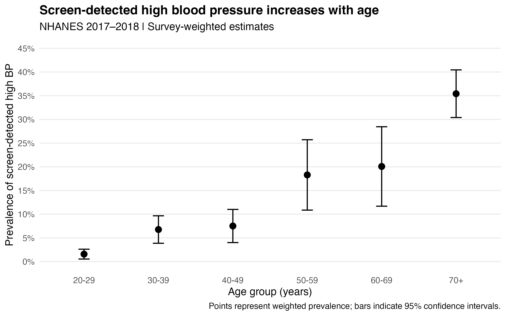
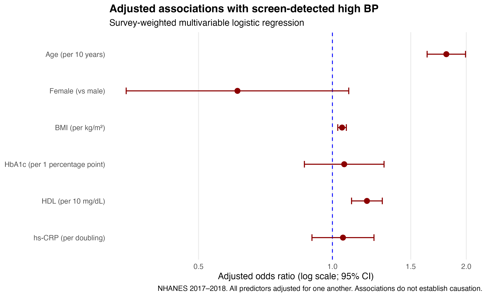
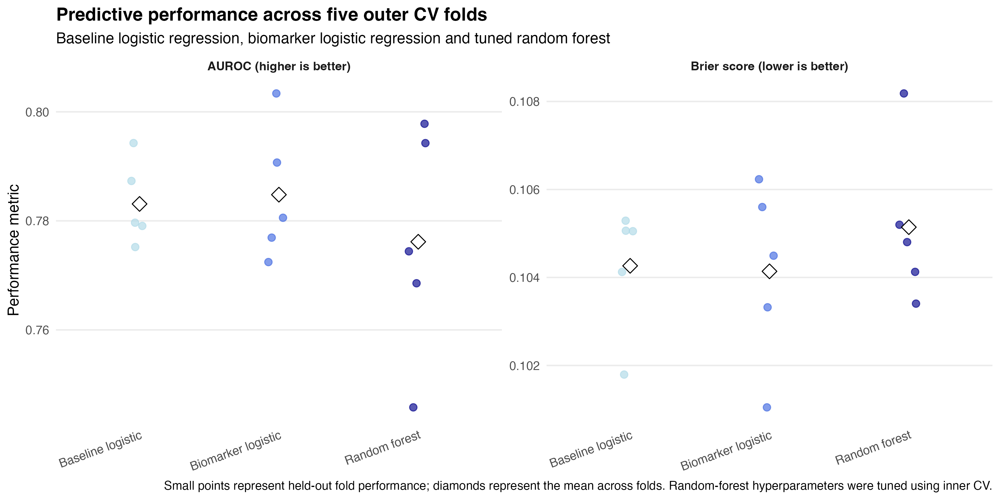
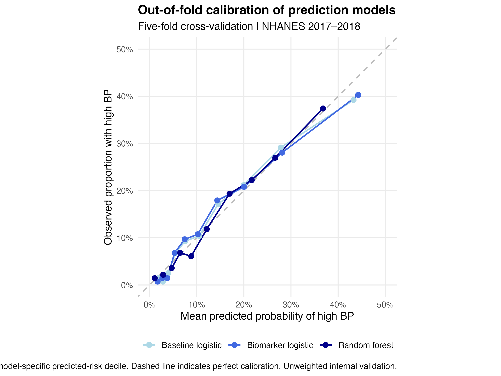
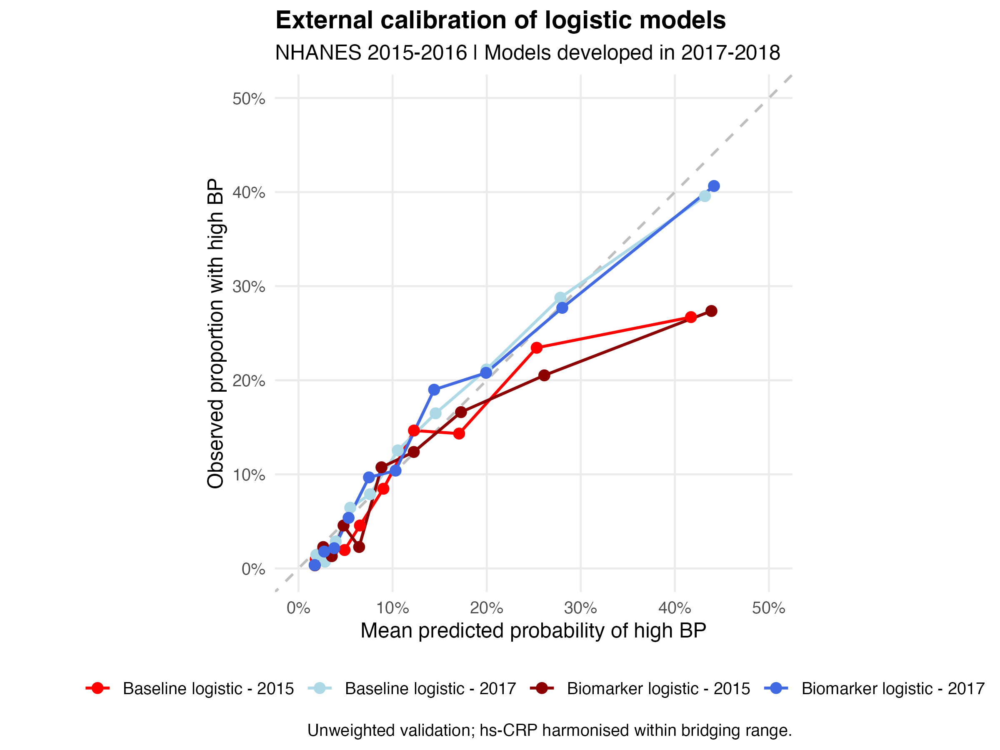

## Screen-Detected High Blood Pressure: Population Epidemiology, Biomarkers and Machine Learning Using NHANES 2017–2018

### Overview

Early identification of high blood pressure (HBP) is an important component of cardiovascular disease prevention. Hypertension is a major modifiable risk factor for cardiovascular disease, yet HBP may remain unrecognised until complications develop.

This project investigates whether routinely measured metabolic and inflammatory biomarkers, or more flexible machine-learning methods, improve identification of screen-detected HBP beyond basic demographic and anthropometric characteristics.

Using publicly available data from the US National Health and Nutrition Examination Survey (NHANES) 2017–2018, the analysis combines:
**Population epidemiology and demographics:** Survey-weighted estimation of HBP prevalence among adults without previously reported hypertension. Readily available demographics, age, sex and body mass index (BMI), were used to act as a baseline for explorations into potential associated biomarkers. **Biomarker analysis:** Investigation of the associations of glycated haemoglobin (HbA1c), high-density lipoprotein (HDL) cholesterol and high-sensitivity C-reactive protein (hs-CRP) with HBP. **Predictive modelling:** Comparison of logistic regression and random forest using internal cross-validation.

The central research question this analysis aims to answer is:

**Do additional biomarkers or nonlinear machine-learning methods meaningfully improve identification of screen-detected high blood pressure beyond age, sex and BMI?**

This is an observational, cross-sectional research exercise. The outcome represents HBP measured during a single examination, not clinically confirmed hypertension or future cardiovascular events.

------------------------------------------------------------------------

### Research objectives

The project addresses four objectives:

Estimate the prevalence of screen-detected HBP among adults without previously reported hypertension, accounting for the NHANES complex sampling design. Examine associations between demographic, anthropometric and biological characteristics and HBP. Assess whether HbA1c, HDL cholesterol and hs-CRP provide additional predictive information beyond age, sex and BMI. Evaluate whether a tuned random forest improves discrimination or probability accuracy relative to conventional logistic regression.

### Data source and study population

Data was obtained from the National Health and Nutrition Examination Survey (NHANES) 2017–2018.NHANES combines interviews, physical examinations and laboratory measurements using a complex, multistage probability sampling design resulting in over-sampling of some minority groups.

Seven public-use datasets were integrated using the unique participant identifier (SEQN). The seven datasets were: BMX_J, BPQ_J, BPX_J, DEMO_J, GHB_J, HDL_J and HSCRP_J.
Source: <https://www.cdc.gov/nchs/nhanes/>

Participants were included in the screening population if they met the criteria: aged 20 or older, completed the mobile examination centre (MEC) exam and has positive MEC examination weight, reported no previous HBP diagnosis and three paired systolic and diastolic blood pressure measurements.

Participants reporting previous hypertension diagnosis were excluded to focus on identification of HBP among adults without a reported prior diagnosis.For prediction modelling, participants additionally required complete data for BMI, HbA1c, HDL cholesterol and hs-CRP.

The initial NHANES dataset contained 9,254 participants. Figure 1 shows how selection of participants proceeded through the analysis.

------------------------------------------------------------------------

### Outcome definition and predictors

The HBP was defined as: **Mean systolic blood pressure ≥140 mmHg and/or mean diastolic blood pressure ≥90 mmHg.**

Mean systolic and diastolic blood pressures were calculated from three complete paired examination readings.

The resulting binary outcome was: 0 - no screen-detected HBP, 1 - screen-detected HBP

This threshold provides a clinically recognisable screening definition. However, a single examination cannot establish persistent hypertension, and confirmation using repeated measurements or out-of-office monitoring would be required for clinical diagnosis.

Two sets of predictors were compared. Baseline predictors comprised: age, sex and BMI. Biomarkers comprised: HbA1c, HDL cholesterol and hs-CRP. Age was rescaled to decades to aid interpretation of regression coefficients. hs-CRP was transformed using log2() because of its strongly right-skewed distribution. On this scale, a one-unit increase corresponds to a doubling of hs-CRP concentration.

All prediction models were evaluated using the same complete-case participants.

------------------------------------------------------------------------

### Statistical methodology

NHANES employs a complex sampling design involving unequal selection probabilities, stratification and clustering. To account for this structure, population-level analyses used the R survey package, incorporating: MEC examination weights, masked variance strata and masked primary sampling units.

Overall prevalence was estimated using svyciprop() with a logit-based 95% confidence interval. Age- and sex-specific prevalence estimates were calculated using svyby().

Survey weighting supports population inference under the sampling-design assumptions, although exclusions due to missing examination and biomarker data may introduce additional selection bias.

Two survey-weighted logistic regression models were fitted using svyglm() with a quasibinomial family.
Model 1 (baseline model): Age + sex + BMI
Model 2 (biomarker model): Age + sex + BMI + HbA1c + HDL cholesterol + log2(hs-CRP)

Adjusted odds ratios and 95% confidence intervals were calculated by exponentiating regression coefficients and their confidence limits. A design-adjusted joint Wald test assessed whether the three biomarkers collectively contributed association information beyond the baseline predictors. Since HDL cholesterol showed an unexpected positive association with HBP, additional exploratory analyses examined HDL distributions by age and sex and assessed a quadratic HDL term.

These analyses estimate conditional associations, not causal effects.

Three predictive models were compared: model 1 (logistic regression of baseline model), model 2 (logistic regression of biomarker model) and model 3 (probability random forest using the same six predictors as model 2)

Ordinary binomial logistic regression was used for the sample-level prediction comparison, separately from the survey-weighted association models.

Random forest was implemented using the ranger package with 1,000 trees. The method was selected to explore whether nonlinear relationships and interactions could improve predictive performance without requiring these relationships to be specified manually.

Nested five-fold cross-validation was used as the primary prediction-model evaluation framework which comprised of:
Dividing the complete dataset into five outcome-stratified outer folds. 
Fitting logistic models using each outer training sample.
Creation of five inner folds within each outer training sample for random-forest hyperparameter selection.
Selection of random-forest hyperparameters using mean inner-validation AUROC.
Refitting the selected forest using the full outer training sample.
Evaluating all three models on the same held-out outer test sample.

Individual held-out predictions were retained for calibration assessment.Folds were constructed at participant level rather than according to NHANES sampling clusters, and the prediction models were not survey-weighted.

Two complementary metrics were used to assess performance of each model: Area under the receiver operating characteristic curve (AUROC) and Brier score.
AUROC assesses discrimination which is the ability of a model to rank a randomly selected participant with HBP above one without HBP. An AUROC of 0.5 corresponds to chance ranking, while 1.0 represents perfect discrimination.
The Brier score measures mean squared error between predicted probabilities and observed binary outcomes. Lower Brier scores indicate better overall probability accuracy. The metric reflects both calibration and discrimination, but does not independently quantify calibration.
Calibration was examined by dividing participants into model-specific predicted-risk deciles and comparing mean predicted probabilities with observed high-BP frequencies.
Both apparent and out-of-fold calibration analyses were undertaken. Out-of-fold calibration was preferred for the final model comparison.

### Results
Among 3,007 screening-eligible adults, 426 met the study definition of HBP.

The survey-weighted prevalence was 11.2% (95% CI 9.1–13.7%).

Prevalence increased substantially with age. These findings indicate a pronounced age gradient in screen-detected HBP among adults without previously reported hypertension.

In the survey-weighted biomarker-enhanced logistic regression, age and BMI were positively associated with screen-detected HBP. The adjusted odds ratio for age was approximately 1.80 per decade, while BMI had an adjusted odds ratio of approximately 1.05 per kg/m². HDL cholesterol also showed a positive adjusted association, with an odds ratio of approximately 1.20 per 10 mg/dL increase.

A design-adjusted joint Wald test suggested that the three biomarkers collectively contributed additional association information beyond the baseline predictors (p ≈ 0.0012).mExploratory assessment of a quadratic HDL term did not provide strong evidence of improvement (p ≈ 0.485). Note: the unexpected HDL association should be interpreted cautiously and does not imply that increasing HDL causes HBP.

Nested cross-validation demonstrated broadly similar discrimination between the two logistic regression models.
Adding the biomarkers increased mean AUROC by approximately 0.0017 and reduced mean Brier score by approximately 0.00013.
The tuned random forest did not outperform either logistic model on average. Its mean AUROC was approximately 0.0086 below that of the biomarker-enhanced logistic model.

The observed differences were small and should not be interpreted as establishing statistically significant superiority of one algorithm.

Calibration was assessed using held-out predictions generated during the outer cross-validation procedure. Participants were grouped into predicted-risk deciles separately for each model. Within each group, mean predicted probability was compared with the observed proportion of participants meeting the elevated-BP definition. The resulting plot allows visual assessment of underprediction and overprediction across the estimated-risk range.

------------------------------------------------------------------------

### Discussion

This exploratory study integrated survey-based epidemiology, biological measurements and predictive modelling to investigate identification of screen-detected HBP.

Three findings emerged:
**First, screen-detected HBP was present among a meaningful proportion of adults without previously reported hypertension.** The estimated prevalence increased markedly with age, highlighting the potential importance of blood-pressure assessment in cardiovascular prevention.
**Second, statistical association did not translate into substantial incremental predictive performance.** Although the additional biomarkers were jointly associated with the outcome in the survey-weighted model, their inclusion produced only a very small improvement in held-out AUROC and Brier score.
**Third, greater algorithmic complexity did not produce superior average performance.** The tuned random forest did not outperform conventional logistic regression within the evaluated sample.
The results should not be read as evidence that these biomarkers or machine-learning methods lack inherent value in cardiovascular research rather their utility may differ with alternative outcomes, richer predictor sets, larger datasets or longitudinal study designs.

------------------------------------------------------------------------

### Limitations

There were several limitations with this analysis which should not be forgotten:
**Cross-sectional design.** The analysis examines contemporaneous associations with measured BP and cannot establish causality or predict future cardiovascular events.
**Screening outcome.** HBP was identified during a single NHANES examination. This is not equivalent to clinically confirmed hypertension.
**Self-reported previous diagnosis.** Eligibility was determined using participants' responses to a previous-hypertension question. Misclassification or recall error may affect the study population.
**Missing data and selection.** Prediction modelling used complete-case participants. Exclusions due to unavailable laboratory or examination data may introduce selection bias and limit generalisability.
**Limited biomarker panel.** Only HbA1c, HDL cholesterol and hs-CRP were evaluated as additional biological predictors. These do not capture the full complexity of cardiovascular disease biology.
**Survey design and prediction.** Population prevalence and association analyses incorporated NHANES survey weights, strata and clusters. However, the prediction models and internal-validation procedures used unweighted participant-level analyses. Predictive performance therefore should not be assumed to represent the entire US adult population.

------------------------------------------------------------------------

### Update to include external calibration of logistic models using NHANES 2015-2016 data

The model was calibrated on the original 2017-2018 NHANES dataset with both AUROC and Brier scores consistent with the original calibration. The calibrated model was then applied to the 2015-2016 dataset (n = 3,072; 302 events) to compare how the model was able to predict in an external environment.

Both models demonstrated good discrimination, with AUROCs of 0.781 for the baseline logistic model and 0.777 for the biomarker logistic model, alongside similar Brier scores (0.0833 and 0.0836, respectively). Calibration slopes were reasonably close to 1 (0.922 and 0.877), although negative calibration intercepts (−0.308 and −0.340) indicated  overprediction of hypertension risk. The baseline model demonstrated marginally better overall performance, with no apparent improvement from biomarker inclusion. Overall, these findings suggest reasonable temporal transportability of the models across NHANES survey cycles, although some recalibration may be beneficial to improve absolute risk predictions.

### Reproducibility

The analysis was conducted in RStudio using the following packages: haven, dplyr, ggplot2, survey, pROC, ranger, rsample and tidyr.

Running the project:
1.  Install R and the required packages.
2.  Clone or download this repository.
3.  Open the project in RStudio and set the working directory to the repository root.
4.  Run the analysis script from the beginning.
5.  The script will download the required NHANES 2017–2018 `.XPT` files into `data_raw/` if they are not already present.
6.  Execute the analysis to reproduce the cohort selection, statistical models, internal validation and figures.
Random seeds are specified for stochastic procedures to support computational reproducibility.

The five figures are saved in the figures/ directory:
- figure1_participant_flow.png
- figure2_weighted_prevalence_age.png
- figure3_adjusted_odds_ratios.png
- figure4_model_comparison.png
- figure5_oof_calibration.png

The analysis also produces model summaries, survey-weighted prevalence estimates, bootstrap validation results and nested-CV performance tables.

------------------------------------------------------------------------

### Data availability and attribution

All source data are publicly available through the US Centers for Disease Control and Prevention's National Health and Nutrition Examination Survey: National Center for Health Statistics, National Health and Nutrition Examination Survey, 2017–2018 (https://www.cdc.gov/nchs/nhanes/).

This project is an independent educational and exploratory research analysis. It is not affiliated with, endorsed by or conducted on behalf of any other party.

------------------------------------------------------------------------

### Conclusion
**The central finding is that additional biological information and greater computational complexity did not necessarily translate into meaningful predictive improvement within this dataset.**

